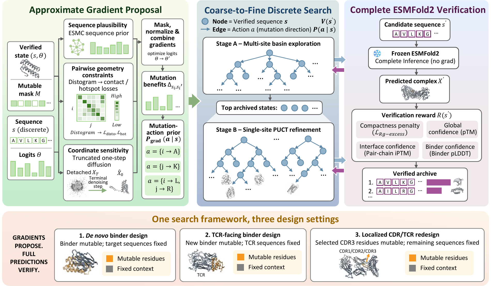
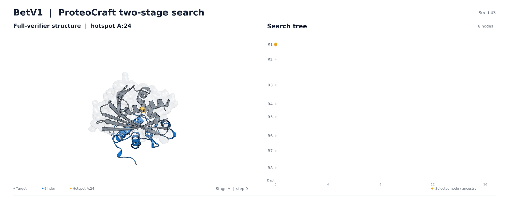

[English](README.md) | [简体中文](README.zh-CN.md)

ProteoCraft designs protein binders with frozen ESMFold2 models. It combines
gradient-guided sequence proposals with two-stage Monte Carlo tree search
(MCTS), using full complex predictions to select candidates. This repository
provides the ESMFold2 mainline.

[Paper (PDF)](docs/ProteoCraft.pdf) · [Quickstart](#quickstart) · [Installation](#install) · [Task examples](docs/USAGE.md)

## Quickstart

Complete the [installation and model setup](#install), then run a short test
from the repository root:

```bash
python scripts/smoke_test.py --device cuda:0
```

The test uses Bet v 1 for two Stage A rounds and two Stage B rounds, retaining
default acceleration and 4×50 structure verification. It checks the environment
and models first, then checks the saved structure and matching metrics. Success
prints `Smoke test passed`. Results are under `outputs/smoke/denovo_BetV1/`, with
the final structure at `esmfold2_artifacts/checkpoints/final/step_0004/step_0004_best.cif`.
The first run compiles GPU kernels. Use the full search for design:

```bash
python benchmark/script/run_esmfold2_59.py \
  --case denovo_BetV1 --device cuda:0 --output-dir outputs/example_betv1
```

Full results are under `outputs/example_betv1/denovo_BetV1/`.
On CPU, `python scripts/smoke_test.py --prepare-only` checks inputs and writes
the short-test profile.

## Supported tasks

Four task adapters share the same two-stage search:

| Task | What to provide | Designed sequence |
|---|---|---|
| [De novo binder design](docs/USAGE.md#de-novo-binder-design) | Target sequence(s) and binder length | Entire binder |
| [TCR binder design](docs/USAGE.md#tcr-binder-design) | TCR α/β sequences and binder length | Entire binder |
| [Local/CDR redesign](docs/USAGE.md#localcdr-redesign) | Target, starting binder, mutable positions; fixed partner chains as needed | Explicit mutable positions |
| [VHH redesign](docs/USAGE.md#vhh-all-cdr-redesign) | Target, starting VHH and IMGT CDR position mapping | All three CDRs |

Redesign preserves amino acids outside the mutable region and predicts the
complex structure anew by default.

## How it works

The structure models stay frozen; the search changes the binder sequence.

1. **Provide inputs:** target sequences and a binder length, or a starting binder
   with explicit mutable positions for redesign.
2. **Explore in Stage A:** start from multiple roots, use gradients to propose
   sequence changes, and verify discrete candidates with full ESMFold2 predictions.
3. **Refine in Stage B:** continue the tree search using single-residue mutations
   and full structure verification.
4. **Save the result:** a selected binder sequence, its predicted complex
   structure, matching metrics and the search records.



*Method overview from the ESMFold2 manuscript.*

<!-- Figure provenance: authors' ESMFold2 overview, 2026-09-26.
Source PDF SHA-256: d68a709bdadb14b5887d002e9e0064511e5b3ca1fd0a3202c16efeb0cf802aef.
-->

The bundled `esmfold2_d` profile supplies the search settings automatically:

| Setting | Default |
|---|---|
| Seed | 43 |
| Initial roots | 8 |
| Stage A / Stage B rounds | 70 / 40 |
| Soft updates per proposal, Stage A / Stage B | 30 / 20 |
| Search verifier | 4 loops × 50 sampling steps |
| Proposal / verifier / ESMC acceleration | `fast / fast / exact` |

See the [core algorithm](docs/ALGORITHM.md) for loss functions, candidate
selection and handoff rules.

## Search in action

<a href="docs/assets/search-replay-1080p.mp4?raw=true"></a>

*Archived Bet v 1 ESMFold2 search. Left: predicted complex. Right: search tree.*

<!-- Replay provenance: betv1-two-stage-seed43 from the 2026-10-18 animation kit.
110 video frames cover the original 110-step search; playback is 27.5 s.
The GIF retains the original width and crops to the structure/tree panels.
The MP4 is the original unmodified four-panel recording. -->

## Install

Design runs use **Linux x86-64, Python 3.12 and an NVIDIA CUDA GPU**.
The default acceleration requires an SM80/SM90 GPU and the pinned dependencies
installed below. CPU execution supports tests and input preparation.

```bash
git clone https://github.com/smiles724/ProteoCraft_v1.git
cd ProteoCraft_v1

git clone https://github.com/anthropics/uplifting-biomolecular-modeling.git ../uplifting-biomolecular-modeling
git -C ../uplifting-biomolecular-modeling checkout --detach f4f62fa6592ae4938d49b1757bea0cfeff9f468e
export PROTEOCRAFT_UPLIFT_ROOT="$(cd ../uplifting-biomolecular-modeling && pwd)"

export PROTEOCRAFT_WORKDIR="$HOME/proteocraft-runtime"
bash environment/esmfold2/install_optimization.sh "$PROTEOCRAFT_WORKDIR/env"
source "$PROTEOCRAFT_WORKDIR/env/activate_proteocraft.sh"
python environment/esmfold2/download_models.py \
  --cache-dir "$PROTEOCRAFT_WORKDIR/models" \
  --write-env "$PROTEOCRAFT_WORKDIR/env/activate_proteocraft.sh"
source "$PROTEOCRAFT_WORKDIR/env/activate_proteocraft.sh"
```

Prepare Python 3.12, `venv`, Git and a C compiler first; see the [Ubuntu setup](docs/INSTALLATION.md#system-prerequisites).
Choose a disk with enough space for `PROTEOCRAFT_WORKDIR`: the three models total
about **25.6 GiB**, plus the environment and download cache. The installer checks
dependencies, sources and the GPU; the downloader checks model file completeness.

After logging in again, restore the environment and model paths with one command
from the repository root:

```bash
source "$HOME/proteocraft-runtime/env/activate_proteocraft.sh"
```

Use your chosen directory here if you changed `PROTEOCRAFT_WORKDIR`.

For capacity planning, the full 110-round IFNAR2 VHH run on H200 used a
128-residue binder with 37 mutable positions and peaked at **73.15 GiB allocated
/ 78.18 GiB reserved** by Torch. See [installation details](docs/INSTALLATION.md)
for dependency versions, the validated environment and memory modes.

## Design your own binder

Use `proteocraft` with your target sequence and binder length. This short target
illustrates the command syntax:

```bash
proteocraft \
  --target GIVEQCCTSICSLYQLENYCN \
  --binder_length 80 \
  --output_dir outputs/first_design \
  --device cuda:0
```

The bundled profile loads automatically. Choose the target, binder length or
starting sequence, mutable positions, hotspots, device and output directory for
your task. Add `--target_hotspots "4,8-10"` to designate target residues.
For multiple target chains, join their sequences with `|`; hotspot positions
are **1-based over their concatenation**. Explicit CLI options override profile
values.

The main outputs inside each run directory are:

| Output | Contents |
|---|---|
| `hallucination_result.txt` | Selected binder sequence and resolved settings |
| `esmfold2_artifacts/checkpoints/final/step_0110/step_0110_best.cif` | The selected structure for the default 110-round run |
| `esmfold2_artifacts/checkpoints/final/step_0110/step_0110_best_meta.json` | Metrics from that same structure prediction |
| `esmfold2_artifacts/run_summary.json` | Search summary |

Candidate metrics and trajectory records are also retained. Add
`--esmfold2_save_verified_candidate_cif true` to save every verified candidate's
structure; the final selected structure is saved by default.

See [task examples and outputs](docs/USAGE.md) for redesign, checkpoints and
memory controls, or run `proteocraft --help`. Maintainers can adjust algorithm
settings through the validated YAML profile.

## Prepare the reproducible benchmark

The source checkout includes **14 de novo + 41 TCR + 4 CDR redesign cases**.
After installation, prepare their inputs on CPU or launch a selected design:

```bash
python benchmark/script/run_esmfold2_59.py --prepare-only
# Run the Bet v 1 design on GPU:
python benchmark/script/run_esmfold2_59.py --case denovo_BetV1 --device cuda:0
```

Benchmark inputs and launch scripts are distributed with the source checkout.

## Independent rescoring

`proteocraft-rescore` evaluates fixed candidates with an independent ESMFold2
protocol: **20 loops × 200 sampling steps, three evaluation seeds, external
acceleration off**. It records the protocol and requires complete seed results.

```bash
proteocraft-rescore prepare --manifest /path/to/candidates.jsonl --out-dir outputs/rescore
proteocraft-rescore run --out-dir outputs/rescore --device cuda:0
proteocraft-rescore report --out-dir outputs/rescore
```

See [the candidate manifest format](docs/USAGE.md#independent-rescoring).
Scores describe model predictions; binding, specificity and affinity are
measured experimentally.

## Development

```bash
python -m pip install -e '.[dev]'
python -m pytest -q
python -m build
```

The CPU suite tests search contracts, task masks, configuration, checkpoints
and installation helpers with small tensors and test backends. GitHub Actions
runs the suite, package builds and installed-wheel checks. The
[validation record](docs/MIGRATION.md#validation-scope) documents the H200 IFNAR2
VHH runs, tested code versions and reproducibility findings.

## License and attribution

This is the ESMFold2-only distribution of
[ProteoCraft](https://github.com/smiles724/ProteoCraft).

Software: [Apache 2.0](LICENSE). Original notices are retained in [NOTICE](NOTICE).
External model weights and optimization sources retain their own licenses.
