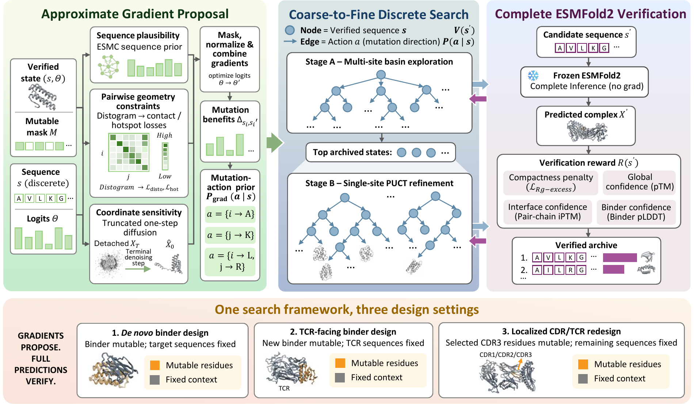
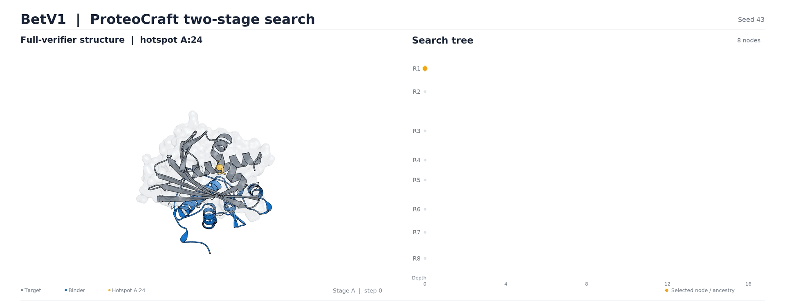

[English](README.md) | [简体中文](README.zh-CN.md)

ProteoCraft 用于设计蛋白质结合分子（binder）。它固定 ESMFold2 模型参数，
结合梯度引导的序列提案与两阶段蒙特卡洛树搜索（MCTS），通过完整复合物预测筛选候选。
本仓库提供 ESMFold2 版本的主干算法。

[论文 PDF](docs/ProteoCraft.pdf) · [快速开始](#快速开始) · [安装](#安装) · [任务示例](docs/USAGE.zh-CN.md)

## 快速开始

先完成[安装与模型配置](#安装)，再从仓库根目录运行短测：

```bash
python scripts/smoke_test.py --device cuda:0
```

短测使用 Bet v 1 输入，运行 Stage A 两轮和 Stage B 两轮，保持默认加速与
4×50 结构验证。程序先检查环境和模型，完成后检查结构与指标是否匹配，
成功时打印 `Smoke test passed`。结果位于 `outputs/smoke/denovo_BetV1/`，
最终结构为 `esmfold2_artifacts/checkpoints/final/step_0004/step_0004_best.cif`。
首次运行需要编译 GPU 内核。短测用于确认安装和计算流程；正式设计使用完整搜索：

```bash
python benchmark/script/run_esmfold2_59.py \
  --case denovo_BetV1 --device cuda:0 --output-dir outputs/example_betv1
```

完整结果位于 `outputs/example_betv1/denovo_BetV1/`。
CPU 上可用 `python scripts/smoke_test.py --prepare-only` 检查输入和生成短测配置。

## 支持的任务

四种任务共用同一套两阶段搜索算法：

| 任务 | 需要准备的输入 | 需要设计的部分 |
|---|---|---|
| [从头设计 binder](docs/USAGE.zh-CN.md#从头设计-binder) | 靶标序列、binder 长度 | 整条 binder 序列 |
| [TCR binder 设计](docs/USAGE.zh-CN.md#tcr-binder-设计) | TCR α/β 链序列、binder 长度 | 整条 binder 序列 |
| [局部/CDR 重设计](docs/USAGE.zh-CN.md#局部cdr-重设计) | 靶标、起始 binder、可变位置；按需添加固定配对链 | 明确指定的可变位置 |
| [VHH 重设计](docs/USAGE.zh-CN.md#vhh-三个-cdr-重设计) | 靶标、起始 VHH、IMGT CDR 位置映射 | 三个 CDR |

重设计保持可变区域之外的氨基酸序列，并默认重新预测复合物结构。

## 运行逻辑

模型参数始终冻结，搜索修改的是 binder 序列：

1. **提供输入：** 靶标序列和 binder 长度；重设计任务还需要起始序列及可变位置。
2. **Stage A 探索：** 从多个初始根节点出发，用梯度提出序列修改，
   再用完整 ESMFold2 预测验证离散候选序列。
3. **Stage B 精修：** 继续树搜索，以单个氨基酸替换为动作，
   同样通过完整结构预测判断候选质量。
4. **保存结果：** 输出选中的 binder 序列、对应的预测复合物结构、
   与该结构匹配的指标，以及搜索记录。



*ESMFold2 版本论文稿件中的方法总览。*

程序自动载入 `esmfold2_d` 配置：

| 设置 | 默认值 |
|---|---|
| Seed | 43 |
| 初始根节点 | 8 |
| Stage A / Stage B 搜索轮数 | 70 / 40 |
| 每次提案的软序列更新次数，Stage A / Stage B | 30 / 20 |
| 搜索验证 | 4 个循环 × 每循环 50 个采样步 |
| 提案 / 验证 / ESMC 加速模式 | `fast / fast / exact` |

损失函数、候选筛选和阶段交接规则见[核心算法说明](docs/ALGORITHM.md)。

## 动态搜索演示

<a href="docs/assets/search-replay-1080p.mp4?raw=true"></a>

*Bet v 1 ESMFold2 历史搜索回放：左为预测复合物，右为搜索树。*

## 安装

设计运行使用 **Linux x86-64、Python 3.12 和 NVIDIA CUDA GPU**。
默认加速模式要求 SM80/SM90 GPU，以及下方安装的固定版本依赖。
CPU 用于测试和输入准备。

```bash
git clone https://github.com/smiles724/ProteoCraft_v1.git
cd ProteoCraft_v1

git clone https://github.com/anthropics/uplifting-biomolecular-modeling.git ../uplifting-biomolecular-modeling
git -C ../uplifting-biomolecular-modeling checkout --detach f4f62fa6592ae4938d49b1757bea0cfeff9f468e
export PROTEOCRAFT_UPLIFT_ROOT="$(cd ../uplifting-biomolecular-modeling && pwd)"

export PROTEOCRAFT_WORKDIR="$HOME/proteocraft-runtime"
bash environment/esmfold2/install_optimization.sh "$PROTEOCRAFT_WORKDIR/env"
source "$PROTEOCRAFT_WORKDIR/env/activate_proteocraft.sh"
python environment/esmfold2/download_models.py \
  --cache-dir "$PROTEOCRAFT_WORKDIR/models" \
  --write-env "$PROTEOCRAFT_WORKDIR/env/activate_proteocraft.sh"
source "$PROTEOCRAFT_WORKDIR/env/activate_proteocraft.sh"
```

安装前准备 Python 3.12、`venv`、Git 和 C 编译器，Ubuntu 命令见[安装说明](docs/INSTALLATION.md#system-prerequisites)。
将 `PROTEOCRAFT_WORKDIR` 设在空间充足的磁盘：三个模型约 **25.6 GiB**，环境和下载缓存还会占用额外空间。
安装脚本会自动检查依赖、源码和 GPU；模型下载后检查文件完整性。

重新登录服务器后，在仓库根目录执行一条命令即可恢复环境和模型路径：

```bash
source "$HOME/proteocraft-runtime/env/activate_proteocraft.sh"
```

如果修改了 `PROTEOCRAFT_WORKDIR`，这里使用相应目录。

显存规划可参考 H200 上的完整 IFNAR2 VHH 运行：128 个残基的 binder、37 个可变位置、
110 轮搜索，Torch 峰值为 **73.15 GiB 已分配 / 78.18 GiB 已保留**。
依赖版本、已验证环境和内存模式见[安装说明](docs/INSTALLATION.md)。

## 设计自己的 binder

安装后，用 `proteocraft` 指定靶标序列和 binder 长度。下面用一条短靶标演示命令格式：

```bash
proteocraft \
  --target GIVEQCCTSICSLYQLENYCN \
  --binder_length 80 \
  --output_dir outputs/first_design \
  --device cuda:0
```

程序自动载入默认配置。按任务选择靶标、binder 长度或起始序列、可变区域、热点、
运行设备和输出目录。

可添加 `--target_hotspots "4,8-10"` 指定靶标热点。
多条靶标链的序列用 `|` 连接；热点按这些链顺序拼接后的序列，使用 **从 1 开始**的编号。
显式命令行参数优先于配置文件。

默认运行目录中的主要输出如下：

| 文件 | 内容 |
|---|---|
| `hallucination_result.txt` | 选中的 binder 序列及实际运行配置 |
| `esmfold2_artifacts/checkpoints/final/step_0110/step_0110_best.cif` | 默认 110 轮运行最终选中的预测结构 |
| `esmfold2_artifacts/checkpoints/final/step_0110/step_0110_best_meta.json` | 与该结构预测匹配的指标 |
| `esmfold2_artifacts/run_summary.json` | 搜索摘要 |

候选指标和搜索轨迹也会保留。最终选中的结构默认保存；
如需保存每个已验证候选的结构，可添加 `--esmfold2_save_verified_candidate_cif true`。

四种任务、断点恢复和内存管理见[任务示例与输出说明](docs/USAGE.zh-CN.md)，
完整公开参数可通过 `proteocraft --help` 查看。维护者可通过经过校验的 YAML 配置调整算法设置。

## 准备基准案例

源码仓库提供 **14 个从头设计 + 41 个 TCR + 4 个 CDR 重设计案例**。
安装后，可在 CPU 上准备输入，或选择一个案例启动 GPU 设计：

```bash
python benchmark/script/run_esmfold2_59.py --prepare-only

# 在 GPU 上运行 Bet v 1 设计：
python benchmark/script/run_esmfold2_59.py --case denovo_BetV1 --device cuda:0
```

基准输入和启动脚本随源码仓库分发。

## 独立复评分

`proteocraft-rescore` 对固定候选序列进行独立 ESMFold2 复评分：
**20 个循环 × 每循环 200 个采样步、3 个评估 seed、外部加速关闭**。
程序记录评估协议，并要求所有 seed 的结果完整。

```bash
proteocraft-rescore prepare --manifest /path/to/candidates.jsonl --out-dir outputs/rescore
proteocraft-rescore run --out-dir outputs/rescore --device cuda:0
proteocraft-rescore report --out-dir outputs/rescore
```

候选清单格式见[独立复评分说明](docs/USAGE.md#independent-rescoring)。
评分描述模型预测结果，结合、特异性和亲和力通过实验测定。

## 开发与验证

```bash
python -m pip install -e '.[dev]'
python -m pytest -q
python -m build
```

CPU 测试用小型张量和测试后端检查搜索契约、可变区域、配置、断点和安装工具。
GitHub Actions 运行测试、安装包构建和 wheel 安装检查。
[验证记录](docs/MIGRATION.md#validation-scope)列出了 H200 上的 IFNAR2 VHH 运行、
对应代码版本和数值复现情况。

## 许可证与来源

本仓库是 [ProteoCraft](https://github.com/smiles724/ProteoCraft) 的 ESMFold2 专用版本。

软件采用 [Apache 2.0](LICENSE)，原始声明保留在 [NOTICE](NOTICE)。
外部模型权重和加速代码遵循各自许可证。
