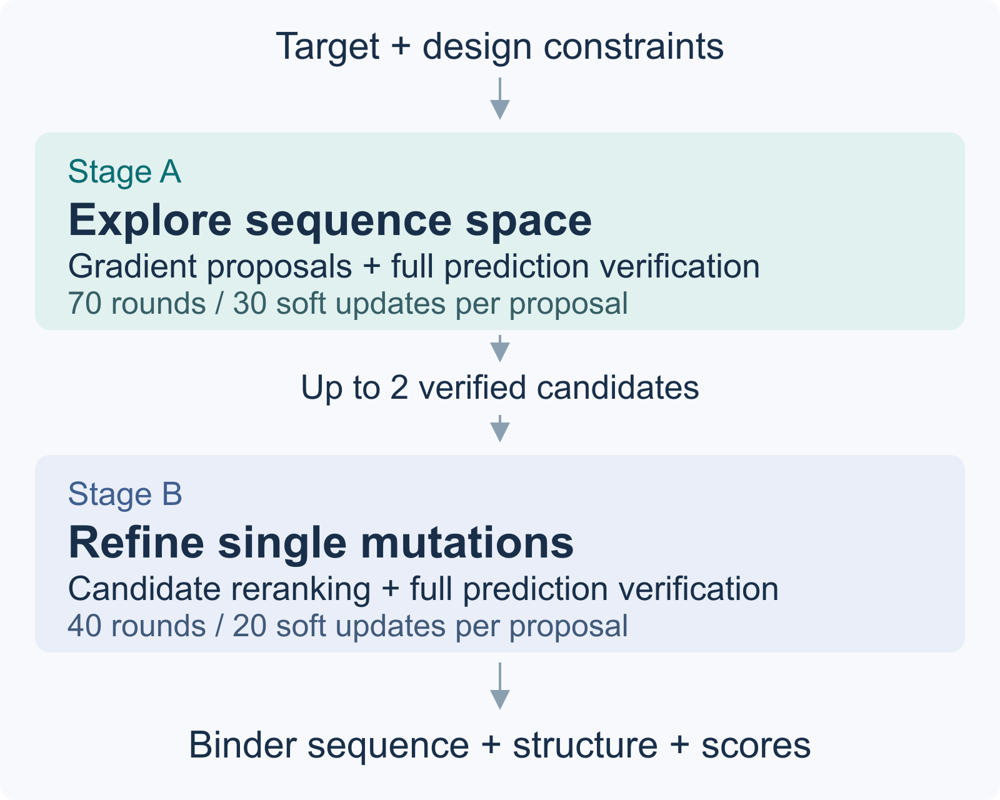

# Core algorithm

ProteoCraft keeps the pretrained ESMFold2 models frozen and optimizes amino-acid
logits for the binder. Target sequences and nonmutable binder positions remain
fixed. Unless an explicit template constraint is selected, coordinates are
predicted anew; a fixed sequence does not imply fixed coordinates.

1. **Stage A: explore sequences.** Initialize several roots and use differentiable
   soft sequence updates. The experimental ESMFold2 model supplies proposal
   gradients, geometry/interface objectives and the ESMC sequence prior. The
   truncated diffusion path performs preceding denoising without gradients and
   differentiates through the final denoising step. Convert logit changes into
   discrete positive-score mutation proposals, alongside a raw argmax proposal.
   The guarded policy protects dominant residues in selected weighted slots.
2. **Verify candidates.** Run the standard ESMFold2 full verifier on discrete
   sequences. These losses guide tree expansion; the cheap proposal loss is not
   substituted for full verification. Candidate records preserve seeds,
   sequences, metrics and provenance.
3. **Stage B: refine.** Hand off selected Stage A states and continue MCTS using
   single-substitution actions. Gradients and sequence priors inform action
   proposals; complete predictions decide candidate quality.
4. **Evaluate independently.** Freeze the chosen sequences and evaluation
   protocol before a separate unoptimized 20×200 rescoring run. This prevents
   search-time acceleration settings and seeds from implicitly becoming the
   evaluation protocol.

The default search budget is summarized below:

The default profile is
`proteocraft/configs/proteocraft_profiles/esmfold2_d.yaml`.
Explicit CLI arguments override the profile. Changing search budgets or kernel
modes can change outcomes; compare them with matched inputs, seeds and evaluation rules.

## Code map

| Module | Responsibility |
|---|---|
| `proteocraft/cli.py` | Parse inputs, load profile, validate task contracts, launch search |
| `hallucination/esmfold2_pipeline.py` | Stage A/B orchestration, tree search, candidate artifacts and checkpoints |
| `hallucination/esmfold2_backend.py` | Configurations, amino-acid logits, mutation sampling, verifier result contracts |
| `hallucination/esmfold2_runtime.py` | Biohub model calls and differentiable proposal updates |
| `hallucination/esmfold2_one_step.py` | Truncated diffusion and common geometry/confidence objectives |
| `hallucination/stage_a_tree.py` | Stage A soft-state tree and hierarchical UCB selection |
| `hallucination/stage_b_tree.py` | Stage B action tree, priors, normalization and archives |
| `hallucination/search_config.py` | Types and choices for maintainer YAML settings |
| `hallucination/mutation_proposer.py` | Discrete substitution candidates and priors |
| `hallucination/esmfold2_cdr.py`, `esmfold2_vhh.py` | Mutable masks, chain roles and framework invariants |
| `hallucination/esmfold2_memory.py`, `esmfold2_optimizations.py` | Model residency and explicit external-kernel adapters |
| `evaluation/` | Frozen independent ESMFold2 rescoring |

Paths beginning with `hallucination/` or `evaluation/` are relative to
`proteocraft/`. The template module
remains because the retained backend imports its contracts and local-redesign
helpers; removing it would change supported redesign semantics. Separate
dual-target fusion launchers and experiments are outside this distribution.
